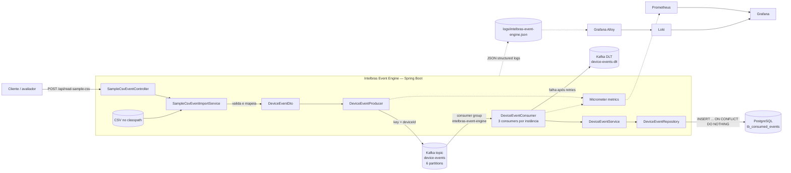
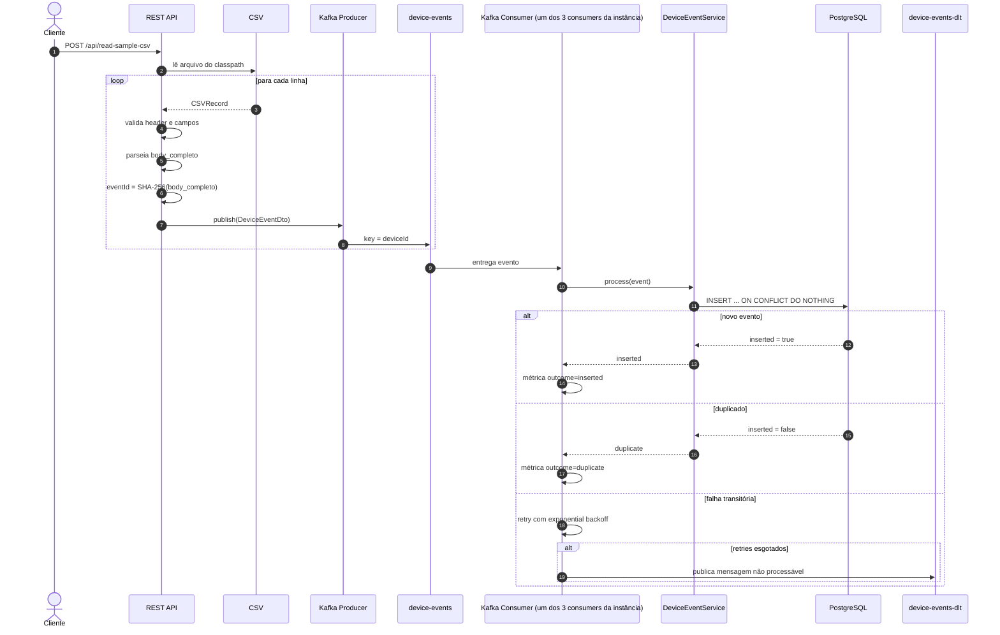
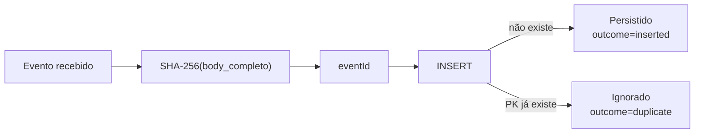
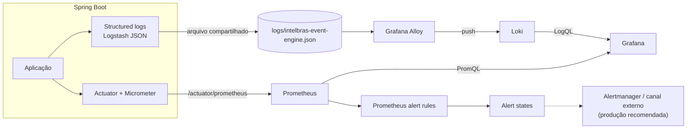
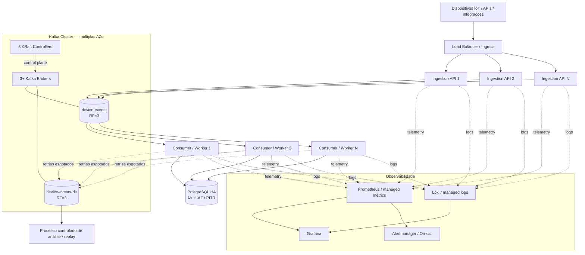

# Intelbras Event Engine

Backend orientado a eventos desenvolvido para o **Case Técnico Intelbras — Backend Sênior Java**. A aplicação simula a entrada dos eventos IoT disponibilizados no dataset do case, publica os eventos no Apache Kafka, realiza o processamento assíncrono com tolerância a falhas, aplica idempotência e persiste os eventos processados em PostgreSQL.

A solução também inclui uma stack local de observabilidade com **Spring Boot Actuator + Micrometer + Prometheus + Grafana + Loki + Grafana Alloy**, além de testes unitários e testes de integração com **Testcontainers**.

> O objetivo deste repositório é demonstrar arquitetura, decisões técnicas, tratamento de falhas e capacidade de evolução para um cenário de milhões de eventos por dia. O ambiente Docker Compose foi projetado para execução e avaliação local; a topologia recomendada para produção real é apresentada separadamente neste documento.

---

## Sumário

- [1. Objetivo do projeto](#1-objetivo-do-projeto)
- [2. Stack](#2-stack)
- [3. Execução rápida](#3-execução-rápida)
- [4. Como disparar o processamento do CSV](#4-como-disparar-o-processamento-do-csv)
- [5. Arquitetura implementada](#5-arquitetura-implementada)
- [6. Fluxo de processamento](#6-fluxo-de-processamento)
- [7. Dataset e tipos de evento](#7-dataset-e-tipos-de-evento)
- [8. Kafka: tópicos, particionamento, ordenação e Consumer Group](#8-kafka-tópicos-particionamento-ordenação-e-consumer-group)
- [9. Idempotência e duplicidade](#9-idempotência-e-duplicidade)
- [10. Retry, falhas e Dead Letter Topic](#10-retry-falhas-e-dead-letter-topic)
- [11. Persistência](#11-persistência)
- [12. Observabilidade](#12-observabilidade)
- [13. Testes](#13-testes)
- [14. Dependências e justificativas](#14-dependências-e-justificativas)
- [15. Estrutura do projeto](#15-estrutura-do-projeto)
- [16. Arquitetura recomendada para produção](#16-arquitetura-recomendada-para-produção)
- [17. Escalabilidade para milhões de eventos por dia](#17-escalabilidade-para-milhões-de-eventos-por-dia)
- [18. Disponibilidade e tolerância a falhas](#18-disponibilidade-e-tolerância-a-falhas)
- [19. Decisões técnicas e trade-offs](#19-decisões-técnicas-e-trade-offs)
- [20. Matriz de atendimento ao case](#20-matriz-de-atendimento-ao-case)

---

## 1. Objetivo do projeto

Este projeto demonstra um backend Java orientado a eventos que importa uma amostra de eventos IoT, publica os dados no Kafka, processa-os de forma assíncrona e persiste os resultados no PostgreSQL com idempotência e tratamento de falhas. Também documenta decisões para evoluir a solução além da amostra do case.

O CSV está empacotado em:

```text
src/main/resources/case_backend_eventos_sanitizados.csv
```

O endpoint HTTP dispara a leitura desse arquivo e a publicação dos eventos no Kafka; não recebe upload de arquivo.

---

## 2. Stack

### Aplicação

- Java 21
- Spring Boot 4.1.1
- Spring for Apache Kafka
- Spring MVC
- Spring JDBC / `JdbcTemplate`
- PostgreSQL 17
- Flyway
- Apache Commons CSV
- Jackson
- Spring Boot Actuator
- Micrometer
- Springdoc OpenAPI / Swagger UI

### Testes

- JUnit 5
- Mockito
- AssertJ
- Awaitility
- Testcontainers
- Kafka Testcontainer
- PostgreSQL Testcontainer

### Infraestrutura local

- Apache Kafka 4.3.1 em modo KRaft
- PostgreSQL 17 Alpine
- Prometheus 3.15.0
- Grafana 13.2.2
- Loki 3.7.8
- Grafana Alloy 1.20.1
- Docker / Docker Compose

---

## 3. Execução rápida

### 3.1 Variáveis de ambiente

O projeto possui valores padrão suficientes para execução local. Caso seja necessário customizá-los:

```bash
cp .env.example .env
```

Variáveis disponíveis:

```dotenv
KAFKA_PORT=9092
APP_HOST_PORT=3000

POSTGRES_PORT=5432
POSTGRES_USER=intelbras
POSTGRES_PASSWORD=intelbras
POSTGRES_DB=intelbrasdb

PROMETHEUS_PORT=9090
GRAFANA_PORT=3001
LOKI_PORT=3100
ALLOY_PORT=12345
```

As variáveis `*_PORT` configuram as portas do host publicadas pelo Docker Compose; as portas internas dos containers permanecem fixas. `APP_HOST_PORT` se aplica ao modo totalmente containerizado. No modo desenvolvimento, a aplicação executada na máquina host continua usando a porta `3000`. Os valores padrão existem exclusivamente para facilitar a execução local. Credenciais reais não devem ser mantidas em arquivos versionados em um ambiente produtivo.

### 3.2 Pré-requisitos

#### Execução totalmente containerizada

Apenas:

- Docker;
- Docker Compose v2.

#### Desenvolvimento com a aplicação rodando na máquina host

Além do Docker:

- JDK 21.

O Maven não precisa estar instalado globalmente, pois o projeto utiliza Maven Wrapper.

### 3.3 Portas utilizadas

| Serviço | Variável no `.env` | Porta local padrão |
|---|---|---:|
| API Spring Boot (modo containerizado) | `APP_HOST_PORT` | `3000` |
| Grafana | `GRAFANA_PORT` | `3001` |
| PostgreSQL | `POSTGRES_PORT` | `5432` |
| Kafka | `KAFKA_PORT` | `9092` |
| Prometheus | `PROMETHEUS_PORT` | `9090` |
| Loki | `LOKI_PORT` | `3100` |
| Grafana Alloy | `ALLOY_PORT` | `12345` |

Se uma porta estiver ocupada, altere a variável correspondente no `.env`. As portas do Compose são vinculadas a `127.0.0.1`, evitando exposição direta para outras interfaces de rede no ambiente local.

### 3.4 Modo containerizado completo — um comando

Para subir **aplicação + Kafka + PostgreSQL + observabilidade**:

```bash
docker compose up --build -d
```

> **Importante:** este é um ambiente *production-like* para avaliação local. Ele não representa uma topologia de produção real de alta disponibilidade, pois utiliza um único nó Kafka, replication factor `1` e uma única instância PostgreSQL.

Acompanhar os logs:

```bash
docker compose logs -f app
```

Parar o ambiente:

```bash
docker compose down
```

Parar e remover também os volumes locais:

```bash
docker compose down -v
```

### 3.5 Modo desenvolvimento

No desenvolvimento, Kafka, PostgreSQL e a stack de observabilidade permanecem em containers, enquanto a aplicação Spring Boot roda diretamente na máquina host.

Um único comando:

```bash
docker compose -f docker-compose.yml -f docker-compose.dev.yml up -d && ./mvnw spring-boot:run
```

O `docker-compose.dev.yml`:

- desabilita o container da aplicação por padrão por meio do profile `container-app`;
- mantém a infraestrutura em Docker;
- configura o Prometheus para coletar métricas da aplicação em `host.docker.internal:3000`.

No Windows, o equivalente para iniciar a aplicação é:

```powershell
mvnw.cmd spring-boot:run
```

Para encerrar a infraestrutura de desenvolvimento:

```bash
docker compose -f docker-compose.yml -f docker-compose.dev.yml down
```

---

## 4. Como disparar o processamento do CSV

Com a aplicação rodando, use os endereços abaixo:

As URLs abaixo usam as portas padrão. Se você alterou alguma porta no `.env`, substitua a porta na URL pela respectiva configuração. `APP_HOST_PORT` vale para a aplicação em modo containerizado; no modo desenvolvimento, use a porta `3000`.

| Tópico | Subtópico | URL |
|---|---|---|
| Processamento do CSV | Disparar leitura e publicação | `POST http://localhost:3000/api/read-sample-csv` |
| Swagger / OpenAPI | Swagger UI | `http://localhost:3000/swagger-ui/index.html` |
| Swagger / OpenAPI | Especificação OpenAPI em JSON | `http://localhost:3000/v3/api-docs` |
| Health check | Estado da aplicação | `http://localhost:3000/actuator/health` |
| Métricas Prometheus | Endpoint do Actuator | `http://localhost:3000/actuator/prometheus` |
| Observabilidade | Prometheus | `http://localhost:9090` |
| Observabilidade | Grafana | `http://localhost:3001` |
| Observabilidade | Loki | `http://localhost:3100` |
| Observabilidade | Grafana Alloy | `http://localhost:12345` |

O endpoint de processamento retorna `HTTP 200` sem corpo quando a leitura do arquivo foi disparada com sucesso.

### Verificando a persistência

Após disparar a amostra:

```bash
docker compose exec postgres \
  psql -U intelbras -d intelbrasdb \
  -c "SELECT COUNT(*) FROM tb_consumed_events;"
```

O CSV versionado no repositório possui **101 registros físicos**: os 100 eventos do dataset original mais uma repetição do `event_number = 90`.

Como o registro repetido possui exatamente o mesmo `body_completo`, seu SHA-256 é igual ao evento original. Portanto, após o processamento completo, são esperados **100 eventos únicos persistidos**.

Executar o endpoint novamente também deve manter os mesmos 100 eventos persistidos, demonstrando o comportamento idempotente.

---

## 5. Arquitetura implementada



A aplicação mantém responsabilidades separadas:

- `sampleimport`: entrada da amostra CSV;
- `deviceevent`: regras relacionadas ao evento, producer, consumer e métricas de domínio;
- `infra.kafka`: configuração transversal do Kafka, tópicos, retry e DLT;
- `db/migration`: versionamento do schema;
- `observability`: infraestrutura Prometheus, Grafana, Loki e Alloy.

---

## 6. Fluxo de processamento



### Comportamento de uma linha inválida no CSV

Uma linha inválida:

1. é registrada em log como `skipped`;
2. não interrompe a leitura das linhas seguintes;
3. não é publicada no Kafka.

Dessa forma, uma entrada malformada não invalida o lote inteiro.

### Semântica do endpoint

O `KafkaTemplate.send(...)` é assíncrono.

O `HTTP 200` do endpoint indica que o arquivo foi lido e que as chamadas de publicação foram iniciadas. Falhas assíncronas de publicação são registradas por callback em logs e métricas.

Em um sistema produtivo em que o cliente precise confirmar o processamento integral do lote, seria recomendável modelar a importação como um **job assíncrono com identificador/status**, em vez de manter uma requisição HTTP aguardando todo o pipeline.

---

## 7. Dataset e tipos de evento

O dataset-base contém 100 eventos com payloads heterogêneos, incluindo tipos como `iotProperty`, `online` e `videoMotion`. O CSV versionado tem uma linha adicional que repete o evento 90.

A aplicação mapeia cada linha válida para um envelope comum com `eventId`, `deviceId`, `messageType`, `payloadJson` e `eventAt`. O `body_completo` é preservado como JSON e persistido em uma coluna `JSONB`, sem exigir um schema específico para cada tipo de evento.

O identificador do dispositivo é lido de `did`; se esse campo não estiver presente, a aplicação usa `deviceId` como fallback.

---

## 8. Kafka: tópicos, particionamento, ordenação e Consumer Group

### Tópicos locais

| Tópico | Partições | Replication factor | Finalidade |
|---|---:|---:|---|
| `device-events` | 6 | 1 | Receber os eventos para processamento. |
| `device-events-dlt` | 6 | 1 | Receber mensagens que não puderam ser processadas após esgotar as tentativas. Usa a mesma quantidade de partições do tópico principal. |

### Chave, ordenação e distribuição

A publicação usa `deviceId` como chave Kafka:

```java
kafkaTemplate.send(eventsTopic, event.deviceId(), event);
```

| Aspecto | Comportamento | Limite ou trade-off |
|---|---|---|
| Ordenação por dispositivo | Eventos do mesmo dispositivo são encaminhados à mesma partição enquanto a quantidade de partições permanecer estável. | Não há ordenação global entre dispositivos diferentes. |
| Paralelismo | Dispositivos diferentes podem ser processados em partições diferentes. | Um dispositivo com volume desproporcional pode concentrar carga em uma partição. |
| Alteração de partições | Permite ampliar o paralelismo disponível. | Pode remapear chaves; planeje a mudança se a ordenação estrita por dispositivo for necessária. |

### Consumer Group e concorrência atuais

O listener usa `groupId = ${spring.application.name}`; no ambiente padrão, o grupo é `intelbras-event-engine`. O Kafka distribui as partições entre os consumers ativos do grupo.

| Configuração | Valor atual | Efeito |
|---|---:|---|
| Concorrência do listener | 3 consumers por instância | Cada instância cria três consumers no mesmo grupo. |
| Partições de `device-events` | 6 | Uma instância pode distribuir as seis partições entre seus três consumers. |
| Consumers ativos úteis no grupo | Até 6 | É limitado pelo número de partições; consumers excedentes ficam sem partições atribuídas. |

Cada instância adicional cria mais três consumers. Em produção, dimensione concorrência por instância e quantidade de instâncias em conjunto, considerando throughput e recursos disponíveis.

### Dimensionamento

Em produção, a quantidade de partições deve ser calculada com base em:

- throughput de pico, e não apenas média diária;
- tempo médio/p95/p99 de processamento;
- throughput sustentável de um consumer;
- crescimento esperado;
- necessidade de paralelismo;
- distribuição das chaves.

Uma forma conceitual de dimensionar é:

```text
partições necessárias
≈
throughput de pico
/
throughput sustentável de um consumer
```

adicionando margem operacional.

---

## 9. Idempotência e duplicidade

A solução utiliza duas camadas complementares.

### 9.1 Geração determinística do identificador

O identificador é calculado com:

```text
SHA-256(body_completo em UTF-8)
```

O mesmo texto de payload produz sempre o mesmo `eventId`.

### 9.2 Restrição no banco

`pk_event_id` é chave primária:

```sql
pk_event_id VARCHAR(64) PRIMARY KEY
```

A persistência utiliza:

```sql
INSERT INTO tb_consumed_events (...)
VALUES (...)
ON CONFLICT (pk_event_id) DO NOTHING
```

Esse mecanismo torna a deduplicação atômica no PostgreSQL.

Mesmo que duas instâncias tentem persistir simultaneamente o mesmo evento, apenas uma inserção será efetivada.

### Resultado



### Trade-off do hash do payload bruto

O hash é calculado sobre o texto exato de `body_completo`.

Consequentemente, dois JSON semanticamente equivalentes podem gerar hashes diferentes se houver, por exemplo:

- alteração na ordem das propriedades;
- espaços adicionais;
- diferenças de representação textual.

Exemplo conceitual:

```json
{"a":1,"b":2}
```

e:

```json
{"b":2,"a":1}
```

representam o mesmo conteúdo lógico, mas não possuem necessariamente o mesmo SHA-256 textual.

Para o dataset do case, o conteúdo original é preservado e essa estratégia é simples e determinística.

Em produção, a preferência seria:

1. utilizar um `eventId` imutável fornecido pela origem, se disponível;
2. ou gerar a chave a partir de campos de negócio estáveis/canonicalizados;
3. manter a constraint única no banco como última linha de defesa.

---

## 10. Retry, falhas e Dead Letter Topic

O processamento Kafka utiliza `DefaultErrorHandler` com `DeadLetterPublishingRecoverer`.

### Política de retry e recuperação

| Situação | Tratamento | Destino após falha |
|---|---|---|
| Falha de processamento sujeita a retry | Até 5 retries, com backoff exponencial iniciado em 2 s, multiplicador 2 e intervalo máximo de 30 s. | `device-events-dlt` quando os retries se esgotam. |
| `IllegalArgumentException` no consumer Kafka | Classificada explicitamente como não retryable; a mensagem é encaminhada sem retries. | `device-events-dlt`. |
| Falha de desserialização | `ErrorHandlingDeserializer` delega ao `JacksonJsonDeserializer`; o tratamento de erro pode preservar os bytes originais. | `device-events-dlt`. |
| Linha inválida no CSV | Registrada como `skipped`; a importação continua com as linhas seguintes. | Não é publicada no Kafka e não vai para a DLT. |

O envio à DLT ocorre na partição correspondente à mensagem original.

### Serialização da DLT

O producer da DLT usa `DelegatingByTypeSerializer` para escolher o serializer conforme o tipo da mensagem:

| Tipo de mensagem | Serializer | Uso |
|---|---|---|
| Objeto Java | `JacksonJsonSerializer` | Serializar eventos desserializados. |
| `byte[]` | `ByteArraySerializer` | Preservar o payload bruto quando a desserialização falha. |

Esse comportamento é coberto por teste de integração.

### Estratégias de retry

| Estratégia | Benefício | Limitação |
|---|---|---|
| Retry bloqueante atual (`DefaultErrorHandler`) | Simples e previsível; ajuda a preservar a ordem da partição durante as tentativas. | A mensagem em retry bloqueia temporariamente o avanço da partição, e backoffs longos reduzem seu throughput. |
| Retry topics não bloqueantes | Pode aumentar o throughput ao liberar a partição enquanto a mensagem aguarda nova tentativa. | Eventos seguintes podem avançar antes da mensagem que falhou, afetando a ordenação por dispositivo. |

A escolha deve considerar os requisitos de ordenação do domínio.

### DLT e ordenação

Após uma mensagem ser enviada para a DLT, o consumer pode seguir com os eventos posteriores da partição.

Se o domínio exigir que nenhum evento posterior seja processado enquanto houver uma lacuna anterior, será necessário um mecanismo operacional diferente, como:

- pausa/quarentena da chave ou partição;
- fila específica por entidade;
- processo de reconciliação antes de liberar novos eventos.

---

## 11. Persistência

A aplicação utiliza PostgreSQL com acesso direto via `JdbcTemplate`.

### Dados persistidos

| Coluna | Tipo | Uso |
|---|---|---|
| `pk_event_id` | `VARCHAR(64)` | Chave primária baseada no identificador idempotente do evento. |
| `device_id` | `VARCHAR(100)` | Identificador do dispositivo. |
| `message_type` | `VARCHAR(50)` | Tipo do evento (`msgType`). |
| `payload` | `JSONB` | Conteúdo completo do evento; mantém flexibilidade para payloads heterogêneos. |
| `event_at` | `TIMESTAMPTZ` | Data e hora do evento. |
| `processed_at` | `TIMESTAMPTZ` | Data e hora da persistência, preenchida por padrão pelo banco. |

### Índices

| Índice | Colunas | Uso |
|---|---|---|
| `idx_tb_consumed_events_message_type` | `message_type` | Filtrar eventos por tipo. |
| `idx_tb_consumed_events_device_event_at` | `device_id`, `event_at` | Consultar eventos em ordem cronológica por dispositivo. |

O schema e os índices são aplicados pela migration Flyway [`V1__create_tb_consumed_events.sql`](src/main/resources/db/migration/V1__create_tb_consumed_events.sql). A escolha de `JdbcTemplate` e seus trade-offs estão resumidos na [seção 19](#19-decisões-técnicas-e-trade-offs).

---

## 12. Observabilidade

A solução implementa os três pontos principais solicitados pelo case:

- logs;
- métricas;
- alertas.

### 12.1 Arquitetura de observabilidade



### 12.2 Logs estruturados

A aplicação grava:

```text
logs/intelbras-event-engine.json
```

Formato:

```text
Logstash JSON
```

Os logs possuem campos estruturados como:

- `eventId`;
- `deviceId`;
- `messageType`;
- `topic`;
- `partition`;
- `offset`;
- `key`;
- `attempt`;
- `outcome`;
- `errorType`.

Isso permite correlação e consulta sem depender apenas de parsing de mensagens textuais.

### 12.3 Pipeline de logs

O Grafana Alloy:

1. monitora o arquivo ativo;
2. também suporta arquivos `.gz` rotacionados;
3. extrai timestamp e nível do JSON;
4. envia os logs ao Loki.

Grafana utiliza Loki como datasource para exploração dos logs.

### 12.4 Métricas customizadas

Principais métricas de domínio:

```text
device.events.publish{outcome=success|failure}
device.events.consumed
device.events.processed{outcome=inserted|duplicate}
device.events.retry
device.events.processing{outcome=inserted|duplicate|failure}
kafka.consumer.delivery.failure
kafka.consumer.dlt{outcome=success|failure}
```

O timer `device.events.processing` possui histogram habilitado, possibilitando análise de latência e percentis.

Além das métricas customizadas, o Actuator disponibiliza métricas da JVM, processo, HikariCP e clientes Kafka.

### 12.5 Prometheus

Prometheus coleta:

```text
/actuator/prometheus
```

a cada 15 segundos.

Em modo containerizado, o target é:

```text
app:3000
```

Em modo desenvolvimento:

```text
host.docker.internal:3000
```

### 12.6 Dashboards Grafana

Dois dashboards são provisionados automaticamente:

```text
observability/grafana/dashboards/intelbras-event-engine.json
observability/grafana/dashboards/intelbras-runtime-infrastructure.json
```

Eles separam:

- indicadores do pipeline de eventos;
- indicadores de runtime e infraestrutura da aplicação.

### 12.7 Alertas configurados

As regras atuais monitoram:

| Alerta | Condição |
|---|---|
| Aplicação indisponível | target ausente/down por 1 min |
| Evento enviado à DLT | ocorrência nos últimos 5 min |
| CPU do processo alta | > 80% por 5 min |
| Heap alto | > 85% por 5 min |
| Heap crítico | > 95% por 2 min |
| Hikari muito utilizado | > 80% por 5 min |
| Hikari esgotado | pool cheio com requests pendentes |
| Consumer lag persistente | lag > 0 por 5 min |
| Falhas Kafka repetidas | >= 3 falhas em 5 min |

### 12.8 Alertas locais x produção

As regras são avaliadas pelo Prometheus, mas o Compose atual **não inclui Alertmanager**.

Portanto, o ambiente local permite:

- visualizar alertas;
- validar regras;
- usar dashboards;

mas não envia notificações externas por e-mail, Slack, PagerDuty etc.

Em produção, o fluxo recomendado é:

```text
Prometheus -> Alertmanager -> canal de plantão/notificação
```

---

## 13. Testes

Executar toda a suíte:

```bash
./mvnw test
```

No Windows:

```powershell
mvnw.cmd test
```

> Os testes de integração utilizam Testcontainers. Portanto, Docker precisa estar disponível durante `mvn test`.

Executar somente o teste de integração principal:

```bash
./mvnw -Dtest=DeviceEventKafkaIntegrationTest test
```

### Cobertura implementada

| Teste | Cobertura |
|---|---|
| `IdempotencyKeyGeneratorTest` | Estabilidade do SHA-256 para o mesmo texto; alteração do hash quando o texto muda. |
| `DeviceEventServiceTest` | Propagação correta do resultado `inserted/duplicate` fornecido pelo repositório. |
| `DeviceEventProducerTest` | Uso de `deviceId` como Kafka key; métrica de sucesso; falha assíncrona e falha síncrona de publicação. |
| `DeviceEventConsumerTest` | Evento inserido ou duplicado; identificação de retry por `deliveryAttempt`; métrica de falha de processamento; propagação da exceção para o error handler. |
| `SampleCsvEventImportServiceTest` | Leitura do CSV versionado; publicação dos 101 registros físicos; mapeamento do primeiro evento; SHA-256 do corpo; fallback de `did` para `deviceId`. |
| `DeviceEventKafkaIntegrationTest` | Pipeline completo com Kafka e PostgreSQL em containers temporários: publicação, consumo e persistência; persistência única no reprocessamento; retry e DLT; exceção não retryable enviada diretamente à DLT; preservação dos bytes originais na DLT em falha de desserialização; continuidade após mensagem problemática. |

### Configuração específica dos testes

Para manter a suíte rápida:

```text
partitions = 1
replication-factor = 1
max-retries = 2
retry interval = 50 ms
```

---

## 14. Dependências e justificativas

### 14.1 Dependências de runtime

| Dependência | Finalidade | Por que foi escolhida |
|---|---|---|
| `spring-boot-starter-kafka` | Producer, consumer, serialização, error handler e administração Kafka | Integração nativa do ecossistema Spring e abstrações maduras para consumers, retry e DLT |
| `spring-boot-starter-webmvc` | API REST | Necessário para disponibilizar o endpoint que dispara a amostra |
| `spring-boot-starter-actuator` | Health e métricas | Expõe health checks e integração operacional da aplicação |
| `micrometer-registry-prometheus` | Exportação de métricas | Permite que o Prometheus colete métricas de domínio e runtime |
| `spring-boot-starter-flyway` | Migrations | Mantém o schema versionado e reproduzível |
| `flyway-database-postgresql` | Suporte específico do Flyway ao PostgreSQL | Necessário para integração da versão atual do Flyway com PostgreSQL |
| `postgresql` | Driver JDBC | Comunicação da aplicação com PostgreSQL |
| `commons-csv:1.12.0` | Parsing do dataset | Trata corretamente CSV com campos quoted contendo JSON e vírgulas |
| `spring-boot-starter-validation` | Infraestrutura de validação | Mantém suporte a Bean Validation para evolução de DTOs/endpoints; o importador atual também possui validações explícitas próprias |
| `springdoc-openapi-starter-webmvc-ui:3.1.0` | OpenAPI e Swagger UI | Facilita avaliação e exploração do endpoint HTTP |

### 14.2 Dependências de teste

| Dependência | Finalidade |
|---|---|
| `spring-boot-starter-actuator-test` | Suporte de testes do módulo Actuator |
| `spring-boot-starter-flyway-test` | Suporte de testes da integração Flyway |
| `spring-boot-starter-kafka-test` | Utilitários e infraestrutura de teste Kafka |
| `spring-boot-starter-validation-test` | Suporte de teste para validação |
| `spring-boot-starter-webmvc-test` | JUnit, assertions, mocks e suporte WebMVC no ecossistema Boot |
| `spring-boot-testcontainers` | Integração entre Spring Boot e Testcontainers via `@ServiceConnection` |
| `testcontainers-junit-jupiter` | Ciclo de vida dos containers com JUnit 5 |
| `testcontainers-kafka` | Kafka real para testes de integração |
| `testcontainers-postgresql` | PostgreSQL real para testes de integração |

### 14.3 Dependências transitivas relevantes

#### Jackson

Utilizado para:

- desserialização Kafka;
- parsing de `body_completo`;
- serialização do DTO para Kafka.

No Spring Boot 4, Jackson é fornecido pela stack Spring utilizada no projeto.

#### JUnit / Mockito / AssertJ

São utilizados nos testes unitários e são fornecidos pela stack de testes Spring Boot.

#### Awaitility

É utilizado no teste de integração para aguardar condições assíncronas sem `Thread.sleep`, por exemplo:

```text
aguardar até que o consumer persista o evento
```

### 14.4 Componentes de infraestrutura

| Componente | Papel | Justificativa |
|---|---|---|
| Apache Kafka | Backbone assíncrono de eventos | Particionamento, Consumer Groups, ordering por partição e desacoplamento |
| PostgreSQL | Persistência + deduplicação atômica | Constraint única, transações, JSONB e consultas operacionais |
| Flyway | Versionamento do banco | Reprodutibilidade de schema |
| Prometheus | Coleta e regras de métricas | Padrão amplamente adotado e integração nativa com Micrometer |
| Grafana | Dashboards | Visualização conjunta de métricas e logs |
| Loki | Armazenamento de logs | Integração natural com Grafana e modelo baseado em labels |
| Grafana Alloy | Coleta de logs | Faz tail/processamento dos logs e envio ao Loki |
| Docker Compose | Ambiente local reproduzível | Permite levantar toda a solução com poucos comandos |

### 14.5 Dockerfile multi-stage

Build:

```text
eclipse-temurin:21-jdk
```

Runtime:

```text
eclipse-temurin:21-jre
```

Vantagens:

- compilador e ferramentas de build não ficam na imagem final;
- runtime menor;
- separação clara entre build e execução.

O Dockerfile executa:

```bash
./mvnw -Dmaven.test.skip=true package
```

Os testes são deliberadamente separados do build da imagem. Em CI/CD, a ordem recomendada é:

```text
testes -> package/image -> publish -> deploy
```

evitando depender de Docker/Testcontainers dentro do estágio de criação da imagem.

---

## 15. Estrutura do projeto

```text
.
├── Dockerfile
├── docker-compose.yml
├── docker-compose.dev.yml
├── pom.xml
├── observability/
│   ├── alloy/
│   │   └── config.alloy
│   ├── grafana/
│   │   ├── dashboards/
│   │   │   ├── intelbras-event-engine.json
│   │   │   └── intelbras-runtime-infrastructure.json
│   │   └── provisioning/
│   ├── loki/
│   │   └── loki.yaml
│   └── prometheus/
│       ├── alert-rules.yml
│       ├── prometheus.yml
│       └── prometheus.dev.yml
└── src/
    ├── main/
    │   ├── java/io/github/LeoRam0s/intelbras/
    │   │   ├── IntelbrasEventEngineApplication.java
    │   │   ├── deviceevent/
    │   │   │   ├── DeviceEventRepository.java
    │   │   │   ├── DeviceEventService.java
    │   │   │   ├── IdempotencyKeyGenerator.java
    │   │   │   ├── dto/
    │   │   │   ├── kafka/
    │   │   │   └── observability/
    │   │   ├── infra/
    │   │   │   └── kafka/
    │   │   └── sampleimport/
    │   └── resources/
    │       ├── application.properties
    │       ├── case_backend_eventos_sanitizados.csv
    │       └── db/migration/
    └── test/
        ├── java/
        └── resources/
```

### Responsabilidades

| Pacote | Responsabilidades |
|---|---|
| `sampleimport` | Simulação da entrada do case: endpoint, leitura do CSV, validação e mapeamento para `DeviceEventDto`. |
| `deviceevent` | Núcleo do fluxo: modelo de transporte, idempotency key, producer, consumer, processamento, persistência e métricas de domínio. |
| `infra.kafka` | Configuração técnica: serializers, DLT producer, error handler, exponential backoff, criação dos tópicos e listener de métricas de retry/DLT. |

Essa separação evita misturar configuração de infraestrutura com regras do fluxo de eventos.

---

## 16. Arquitetura recomendada para produção

A topologia abaixo representa a evolução recomendada para um cenário real de alto volume.

Ela não é o Docker Compose atual.



Os blocos de ingestão e processamento podem:

- continuar no mesmo código-base e ser implantados com configurações diferentes;
- ou ser separados em serviços distintos caso a escala/evolução organizacional justifique.

A separação física permite escalar producer/ingress e consumers independentemente.

---

## 17. Escalabilidade para milhões de eventos por dia

O dimensionamento de produção deve ser baseado em **testes de carga** e requisitos de disponibilidade, evitando valores fixos definidos sem medição.

### 17.1 Controllers

| Aspecto    | Estratégia                                                           |
| ---------- | -------------------------------------------------------------------- |
| Quantidade | `controllers = 2 × falhas_toleradas + 1`                             |
| Quorum     | `quorum = floor(controllers / 2) + 1`                                |
| Critério   | Dimensionado principalmente por disponibilidade, não por throughput. |

---

### 17.2 Brokers

| Aspecto               | Estratégia                                                                                                                                                                                                                                                                                                                                                                                                                                            |
| --------------------- | ----------------------------------------------------------------------------------------------------------------------------------------------------------------------------------------------------------------------------------------------------------------------------------------------------------------------------------------------------------------------------------------------------------------------------------------------------- |
| Quantidade de brokers | `brokers = max(brokers_RF, brokers_throughput, brokers_storage, brokers_failure_domain)`<br><br>**RF:** `brokers_RF >= RF`<br><br>**Throughput:** `brokers_throughput = ceil(throughput_total_cluster / throughput_seguro_por_broker)`<br><br>**Throughput do cluster:** `throughput_total_cluster ≈ (write_throughput × RF) + read_throughput`<br><br>**Storage:** `brokers_storage = ceil(storage_total_replicado / storage_utilizável_por_broker)` |
| Storage total         | `storage_total_replicado ≈ eventos_dia × tamanho_médio_evento × retenção_dias × RF`                                                                                                                                                                                                                                                                                                                                                                   |
| Storage utilizável    | `storage_utilizável_por_broker = capacidade_disco × fator_utilização_segura`                                                                                                                                                                                                                                                                                                                                                                          |
| Throughput seguro     | `throughput_seguro_por_broker = throughput_máximo_medido × fator_segurança`                                                                                                                                                                                                                                                                                                                                                                           |
| Replication Factor    | Definido conforme a tolerância a falhas desejada.                                                                                                                                                                                                                                                                                                                                                                                                     |
| `min.insync.replicas` | `2`, quando compatível com o `RF` definido.                                                                                                                                                                                                                                                                                                                                                                                                           |
| Producer              | `acks=all` + idempotência habilitada.                                                                                                                                                                                                                                                                                                                                                                                                                 |
| Monitoramento         | ISR, under-replicated partitions, throughput, latência, CPU, rede e disco.                                                                                                                                                                                                                                                                                                                                                                            |

---

### 17.3 Particionamento

| Aspecto | Estratégia |
|---|---|
| Chave | Manter `deviceId` enquanto a ordenação por dispositivo for necessária. |
| Throughput seguro por consumer | `consumer_safe = throughput_máximo_por_consumer × fator_segurança` |
| Consumers necessários | `consumers_necessários = ceil(pico_eventos_por_segundo / consumer_safe)` |
| Partições mínimas | `partitions >= consumers_necessários` |
| Margem para crescimento | `partitions = ceil(consumers_necessários × fator_crescimento)` |
| Trade-off | Mais partições aumentam o paralelismo, mas também ampliam metadata, arquivos e custo de rebalance. |

---

### 17.4 Consumers

| Aspecto | Estratégia |
|---|---|
| Consumers necessários | `consumers_necessários = ceil(pico_eventos_por_segundo / consumer_safe)` |
| Instâncias | `instances = ceil(consumers_necessários / concurrency_por_instância)` |
| Limite de consumers ativos | `consumers_ativos <= partitions` |
| Medição de throughput | Medir o throughput máximo por consumer em teste end-to-end: `Kafka → Consumer → PostgreSQL`. |

---

### 17.5 Backpressure

| Condição | Efeito no lag | Interpretação |
|---|---|---|
| `producer_rate > consumer_rate` | `consumer_lag` aumenta. | A produção supera a capacidade atual de consumo. |
| `consumer_rate > producer_rate` durante a recuperação | `consumer_lag` diminui. | Os consumers estão processando o backlog acumulado. |
| Lag cresce continuamente | A fila continua acumulando eventos. | Indica capacidade insuficiente. |

---

### 17.6 Banco de dados

A capacidade end-to-end também depende do PostgreSQL.

Devem ser monitorados:
```
inserts/s
latência de escrita
Hikari pool
CPU
IOPS
storage throughput
```

Aumentar brokers, partitions ou consumers não aumenta a capacidade do sistema caso o banco seja o gargalo.

---

### 17.7 Idempotência

A `PRIMARY KEY` garante unicidade dos eventos persistidos.

Para uma estratégia com retenção da deduplicação:
```
janela_deduplicação >=
    maior_intervalo_possível_de_reprocessamento
```

---

### 17.8 Dimensionamento
```markdown
1. definir pico_eventos_por_segundo
2. definir tamanho_médio_evento
3. medir throughput_seguro_por_broker
4. calcular brokers
5. medir consumer_safe
6. calcular consumers
7. calcular partitions
8. calcular instances
9. executar teste end-to-end
10. validar falhas e recuperação de lag
```

Assim, a configuração de produção é derivada dos requisitos e dos resultados dos testes de capacidade, em vez de utilizar valores fixos previamente definidos.

---

## 18. Disponibilidade e tolerância a falhas

No case, falhas são isoladas por linha ou mensagem. O fluxo usa retry e DLT, persistência idempotente, health checks, observabilidade e testes de integração.

### Recomendações para produção

| Camada | Recomendações |
|---|---|
| Kafka | Replicação entre domínios de falha, `min.insync.replicas` compatível com o RF e producer com `acks=all` e idempotência. O dimensionamento está descrito na [seção 17](#17-escalabilidade-para-milhões-de-eventos-por-dia). |
| Aplicação | Múltiplas réplicas, probes de readiness/liveness, encerramento controlado, rolling deployments e autoscaling por métricas. |
| PostgreSQL | Replicação, failover, backups, Point-in-Time Recovery e recuperação alinhada aos requisitos de RPO/RTO. |
| Observabilidade | Prometheus, Grafana e Loki atendem ao case local. Em produção, disponibilidade e alertas devem atender aos requisitos operacionais. |
| Segurança | O Kafka local usa `PLAINTEXT`. Em produção, avaliar TLS, autenticação, ACLs, gestão de secrets, controles de rede e princípio do menor privilégio. |

---

## 19. Decisões técnicas e trade-offs

| Decisão | Benefício | Trade-off |
|---|---|---|
| Java 21 + Spring Boot | Ecossistema maduro, suporte Kafka, observabilidade e testes | Framework possui footprint maior que uma solução minimalista |
| Kafka para processamento assíncrono | Desacoplamento, buffer durável, particionamento e Consumer Groups | Introduz infraestrutura distribuída e complexidade operacional |
| `deviceId` como Kafka key | Ordenação por dispositivo e paralelismo entre dispositivos | Hot keys podem concentrar carga; aumento de partições pode remapear chaves |
| 6 partições no ambiente local | Demonstra particionamento e permite escala do grupo | Um único broker local não demonstra distribuição física |
| `concurrency = 3` no listener | Permite consumir partições em paralelo dentro de cada instância | Consumers além do número de partições ficam ociosos e ainda consomem recursos |
| SHA-256 do `body_completo` | Id determinístico sem depender de um ID externo | JSON semanticamente igual, mas textual diferente, gera outro hash |
| PK + `ON CONFLICT DO NOTHING` | Deduplicação atômica mesmo sob concorrência | Cada evento ainda chega ao banco |
| PostgreSQL JSONB | Flexibilidade para payloads heterogêneos | Menor tipagem relacional do payload |
| `JdbcTemplate` | SQL explícito, simples e previsível | Menos abstração que ORM para domínios relacionais complexos |
| Retry bloqueante + exponential backoff | Simplicidade e melhor preservação de ordem durante retry | Mensagem problemática pode reduzir throughput da partição |
| DLT | Isola poison messages e mantém fluxo global | Exige processo operacional para análise/replay |
| ErrorHandlingDeserializer | Consumer não cai por payload inválido | Requer atenção à serialização da DLT |
| `DelegatingByTypeSerializer` na DLT | Preserva tanto objetos válidos quanto bytes não desserializáveis | Configuração mais explícita |
| Producer assíncrono | Maior throughput e menor bloqueio da API | HTTP pode concluir antes da confirmação de todos os sends |
| CSV empacotado no classpath | Case totalmente reproduzível | Não é modelo de ingestão recomendado para produção |
| Compose single-node Kafka | Execução local simples | Não oferece HA nem tolerância real à perda de broker |
| Logs em arquivo + Alloy | Fácil demonstração local do pipeline completo | Em orquestradores, stdout/sidecar/agent costuma ser mais natural |
| Flyway | Banco reproduzível e versionado | Mudanças exigem disciplina de migrations |
| Testcontainers | Testa Kafka/Postgres reais | Suíte de integração depende de Docker |

---

## 20. Matriz de atendimento ao case

### Requisitos funcionais

| Requisito | Atendimento | Implementação |
|---|---|---|
| RF01 — leitura e disparo do CSV | ✅ | `SampleCsvEventImportService` + `POST /api/read-sample-csv` |
| RF02 — publicação no Kafka | ✅ | `DeviceEventProducer` |
| RF03 — consumidor(es) | ✅ | `DeviceEventConsumer` |
| RF04 — diferentes tipos de evento | ✅ | Envelope genérico + `messageType` + payload JSON/JSONB |
| RF05 — logs do processamento | ✅ | SLF4J structured logging + arquivo Logstash JSON |

### Requisitos técnicos

| Requisito | Atendimento | Implementação |
|---|---|---|
| RT01 — Java | ✅ | Java 21 |
| RT02 — Apache Kafka | ✅ | Kafka 4.3.1 + Spring Kafka |
| RT03 — responsabilidades organizadas | ✅ | `sampleimport`, `deviceevent`, `infra.kafka`, observability |
| RT04 — erros sem interromper fluxo global | ✅ | skip de linha inválida + retry/error handler + DLT |
| RT05 — duplicados/reprocessamento | ✅ | SHA-256 + PK + `ON CONFLICT DO NOTHING` |
| RT06 — testes automatizados | ✅ | unitários + integração Kafka/PostgreSQL com Testcontainers |

### Bloco A — Implementação

| Item | Status |
|---|---|
| Aplicação Java funcional | ✅ |
| Publicação e consumo Kafka | ✅ |
| Separação de responsabilidades | ✅ |
| Tratamento de falhas | ✅ |
| Reprocessamento/idempotência | ✅ |
| Testes automatizados | ✅ |
| Instruções de execução local | ✅ neste README |

### Bloco B — Arquitetura

| Item solicitado | Seção |
|---|---|
| Diagrama de arquitetura | [Arquitetura implementada](#5-arquitetura-implementada) |
| Escalabilidade | [Escalabilidade para milhões de eventos por dia](#17-escalabilidade-para-milhões-de-eventos-por-dia) |
| Particionamento Kafka | [Kafka](#8-kafka-tópicos-particionamento-ordenação-e-consumer-group) |
| Consumer Groups e paralelismo | [Kafka](#8-kafka-tópicos-particionamento-ordenação-e-consumer-group) |
| Ordenação | [Kafka](#8-kafka-tópicos-particionamento-ordenação-e-consumer-group) |
| Idempotência | [Idempotência](#9-idempotência-e-duplicidade) |
| Retry / mensagens não processáveis | [Retry e DLT](#10-retry-falhas-e-dead-letter-topic) |
| Logs, métricas e alertas | [Observabilidade](#12-observabilidade) |
| Disponibilidade e tolerância a falhas | [Disponibilidade](#18-disponibilidade-e-tolerância-a-falhas) |

### Bloco C — Decisões técnicas

Documentadas em:

- [Dependências e justificativas](#14-dependências-e-justificativas);
- [Decisões técnicas e trade-offs](#19-decisões-técnicas-e-trade-offs).

### Diferenciais do case

| Diferencial | Atendimento |
|---|---|
| Repositório versionado | ✅ |
| Docker Compose | ✅ |
| Métricas e observabilidade | ✅ |
| Testes de integração envolvendo Kafka | ✅ |

---

## Resumo

A implementação busca combinar simplicidade para execução local com decisões compatíveis com um backend orientado a eventos:

```text
CSV
 -> validação
 -> Kafka producer
 -> device-events
 -> Consumer Group
 -> retry / DLT
 -> processamento transacional
 -> deduplicação
 -> PostgreSQL
 -> métricas + logs + alertas
```

O desenho preserva ordenação por dispositivo, suporta reprocessamento idempotente, isola mensagens problemáticas e fornece sinais operacionais suficientes para diagnosticar falhas e planejar escala.

A evolução para produção exige principalmente substituir os componentes single-node do ambiente local por topologias redundantes, dimensionar as partições pelo throughput de pico e acrescentar os mecanismos operacionais de segurança, alerta e replay descritos neste documento.
